# Administrator User Guide

This guide explains the administrator screens in everyday language. Use it when you need to manage partner companies, evaluation forms, reports, imports, or employee access.

## Before you begin

Sign in with your company email and the password provided for your account. Some deployments may offer Microsoft sign-in as well. If you cannot sign in, contact your system administrator. Do not share your password.

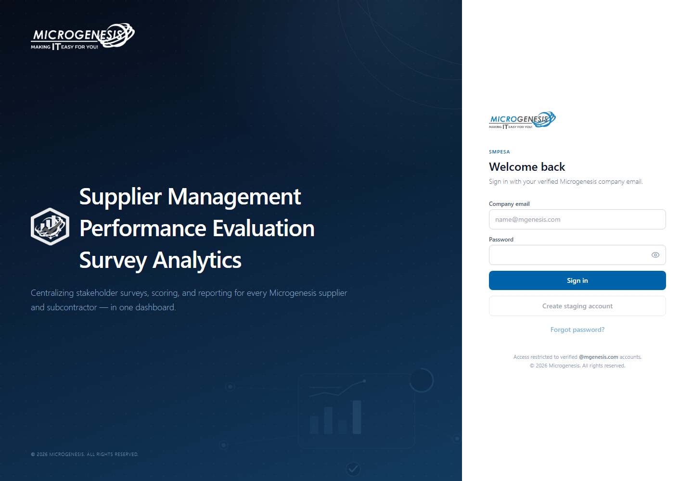

The pictures in this guide show a clean preview account with no partner or survey records. The example email addresses and zero counts are not real company data. Your screen will show the records available to your account.

Your main menu is on the left. Some sections open to show more pages. Click the section name to open or close it, then choose the page you need. The top-right bell opens notifications; your account menu opens Settings.

## Dashboard

The Dashboard is the first page after sign-in. It gives you a quick view of survey activity, partner counts, and performance summaries. Use **Current Period** for the active evaluation period or **All-Time** to include older periods.

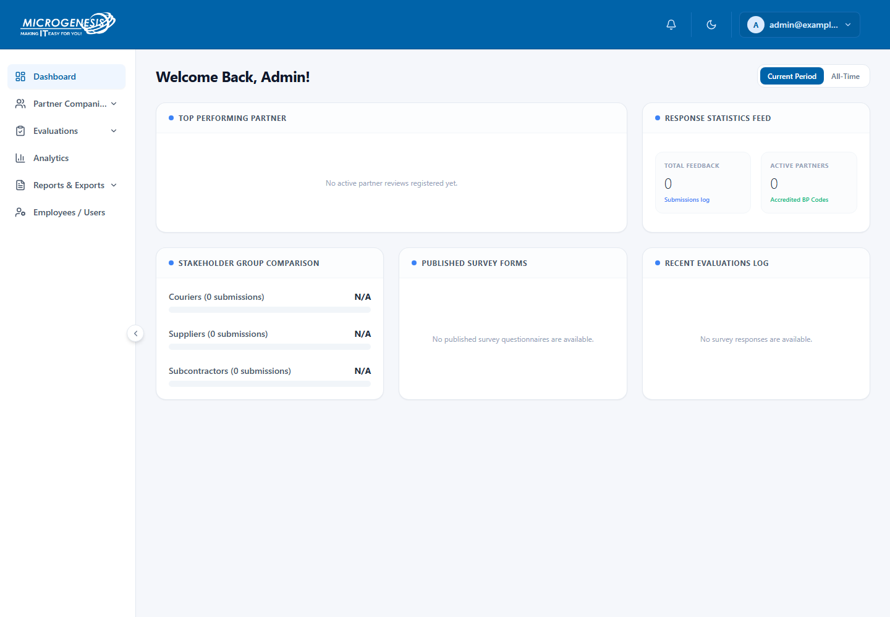

## Partner Companies — Partners

This is the company directory for Couriers, Suppliers, and Subcontractors.

1. Open **Partner Companies**, then choose **Partners**.
2. Search by company name or BP Code. Use the status and category lists to narrow the results.
3. Choose **Register New Partner** to add a company. Fill in the requested company, branch, contact, and document details, then save.
4. To update a company, open its row and change the needed details.

Check the company category and branch before saving. These details affect where the company appears in surveys and reports.

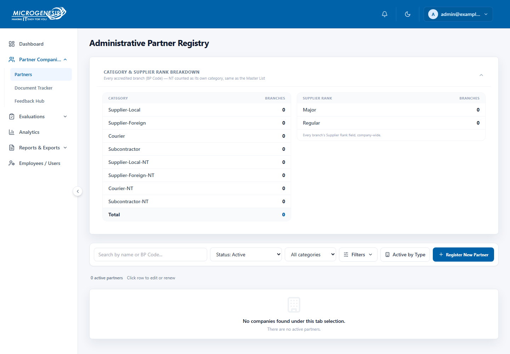

## Document Tracker

The Document Tracker gathers partner compliance documents in one place. It helps you find documents that are missing, expired, or nearing their due date.

1. Open **Partner Companies** → **Document Tracker**.
2. Search by company name or BP Code, or use the filters to narrow the list.
3. Select a document or status to review its details.
4. If you have renewal access, use the renewal action to enter the new date or status and confirm the change.

If you cannot see a renewal action, ask an administrator to grant the document-renewal permission. Check the due date and branch carefully before confirming an update.

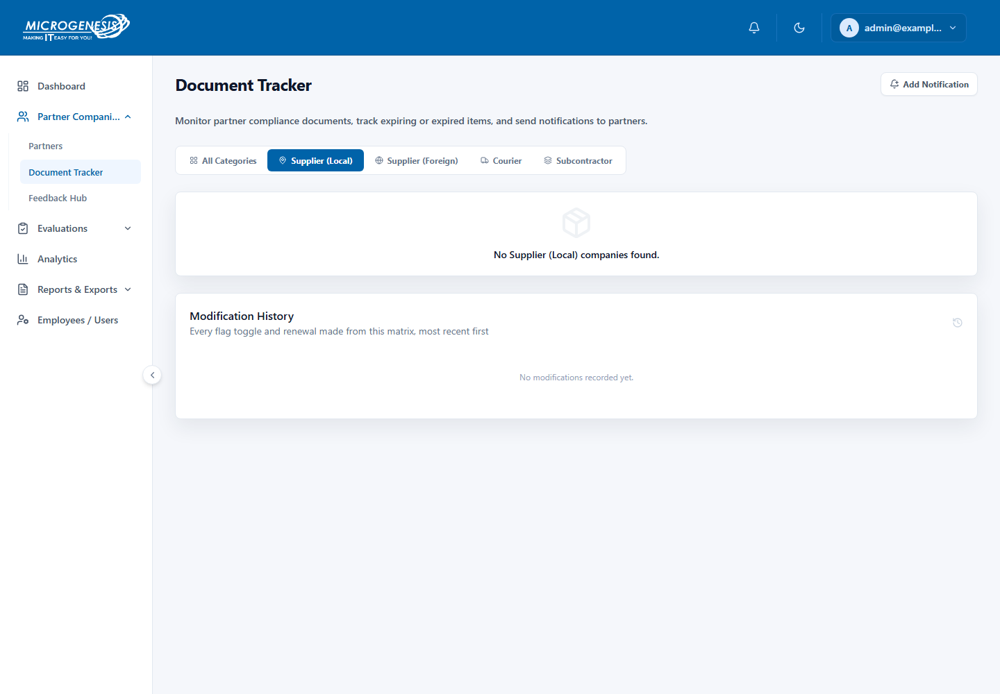

## Feedback Hub

The Feedback Hub helps you prepare and send completed performance reports to partner companies.

1. Open **Partner Companies** → **Feedback Hub**.
2. Choose the completed survey or partner report you want to review.
3. Check the company and recipient details.
4. Choose the single-send or bulk-send option shown on the page, then review the final details before sending.

Email sending works only when Microsoft email has been configured for the system. If sending is unavailable, ask IT; you can still use the reporting and export screens.

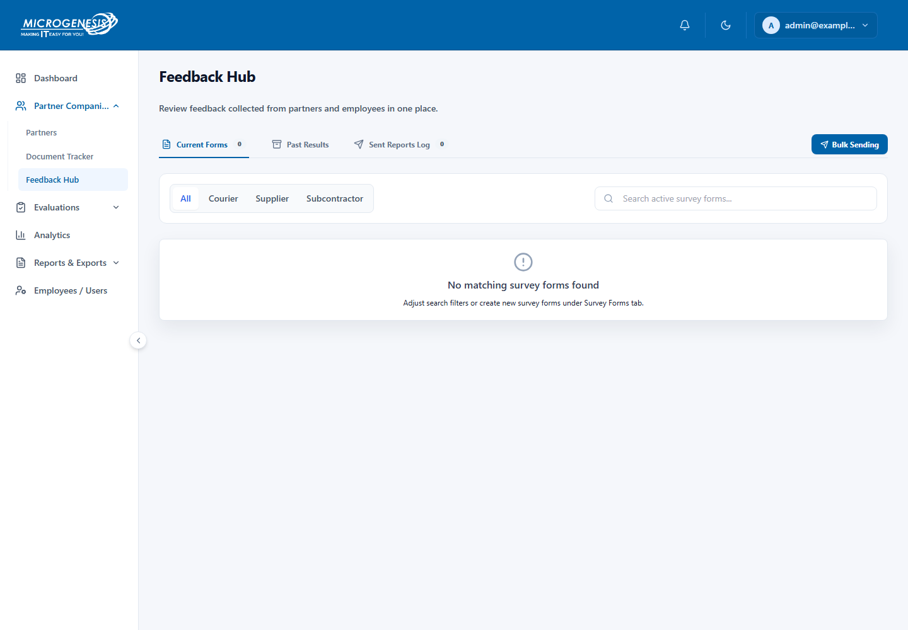

## Evaluation Workspace

Open **Evaluations** → **Evaluation Workspace**. The three tabs organize form setup, submitted answers, and completion progress.

### Forms

Use **Forms** to create and manage evaluation surveys.

1. Choose **Create Form**.
2. Select Courier, Supplier, or Subcontractor and enter the form details.
3. Add the questions, due date, and the employees and companies that should be included.
4. Review the form, then publish it when it is ready for employees.

Use the form's available actions to update it, pause it, or end the evaluation period. Check the confirmation message before ending or archiving a period.

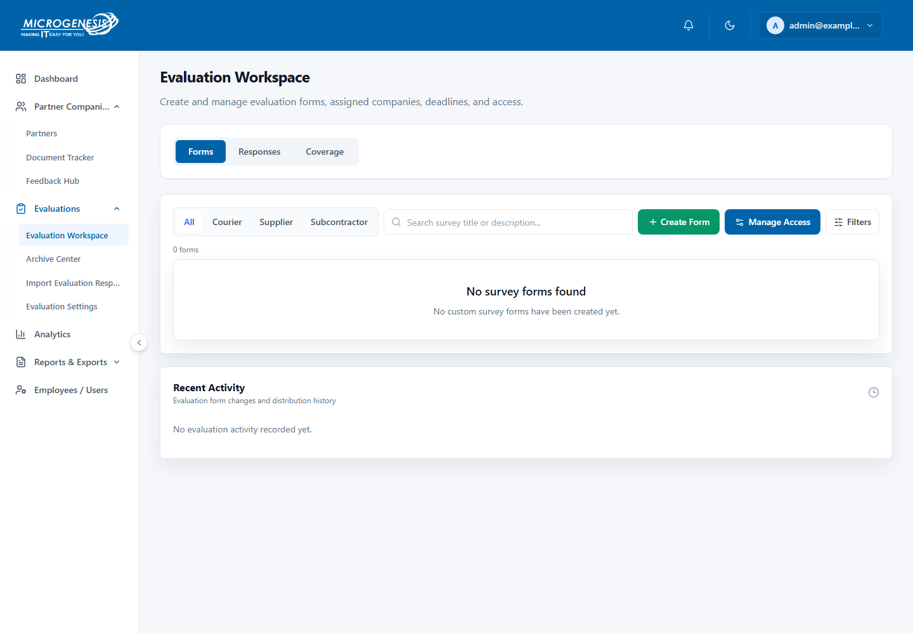

### Responses

Use **Responses** to find a survey and review the answers employees submitted. Select a form to see its responses. Use the export action when you need a spreadsheet copy.

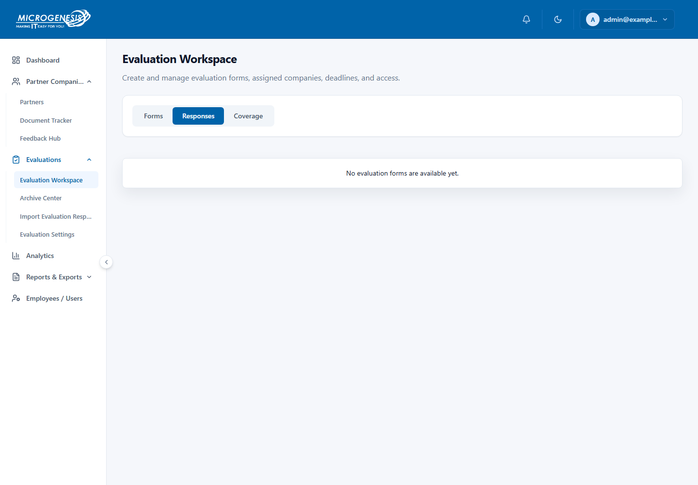

### Coverage

Use **Coverage** to see which assigned companies have an evaluation on record and where work is still outstanding.

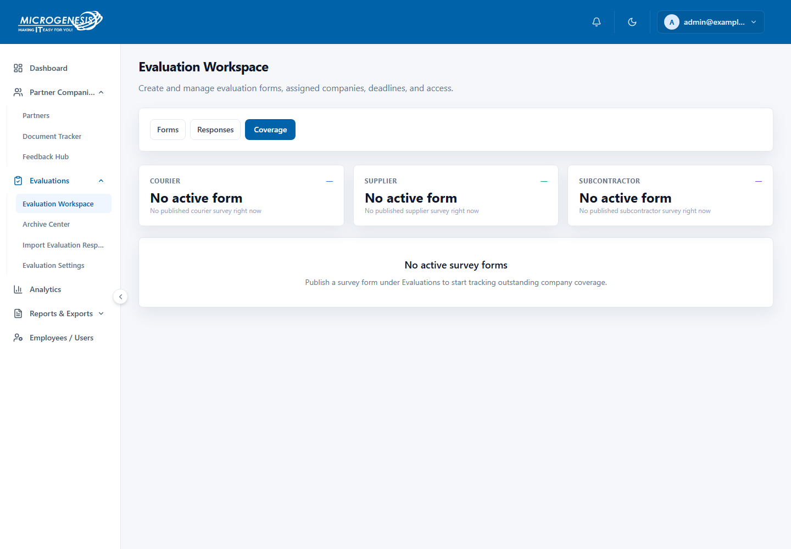

## Archive Center

The Archive Center holds older surveys, submitted responses, and partner records. It has separate sections for **Archived Surveys**, **Archived Responses**, and **Archived Companies**.

1. Open **Evaluations** → **Archive Center**.
2. Choose the section you need, then search or filter the list.
3. Review the item before choosing **Restore** or another action.
4. Confirm the pop-up only after you have checked what it will affect.

Restoring brings an item back to its active area. Permanent deletion cannot be undone. If you need a copy of archived responses, use the export option before changing them.

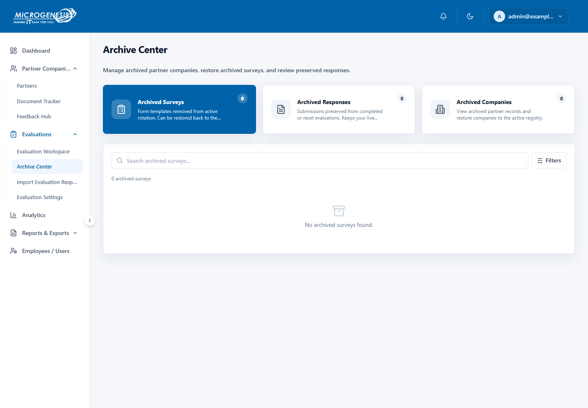

## Import Evaluation Responses

Use this page to bring survey responses from CSV or Excel files into the system.

1. Open **Evaluations** → **Import Evaluation Responses**.
2. Select or drop the response files. You can choose more than one file and include different survey categories.
3. Review the detected forms and company matches.
4. Use **Test import** first if you want to check the files without replacing existing evaluations.
5. When the preview is correct, choose **Import selected files** and review the result.

If the system finds a duplicate source file, it may ask you to choose what should be replaced. Do not replace an existing file unless you have checked the file name and contents. In **Stored Source Files**, moving an import to history keeps its responses and source file; permanently removing an item from history is a separate action.

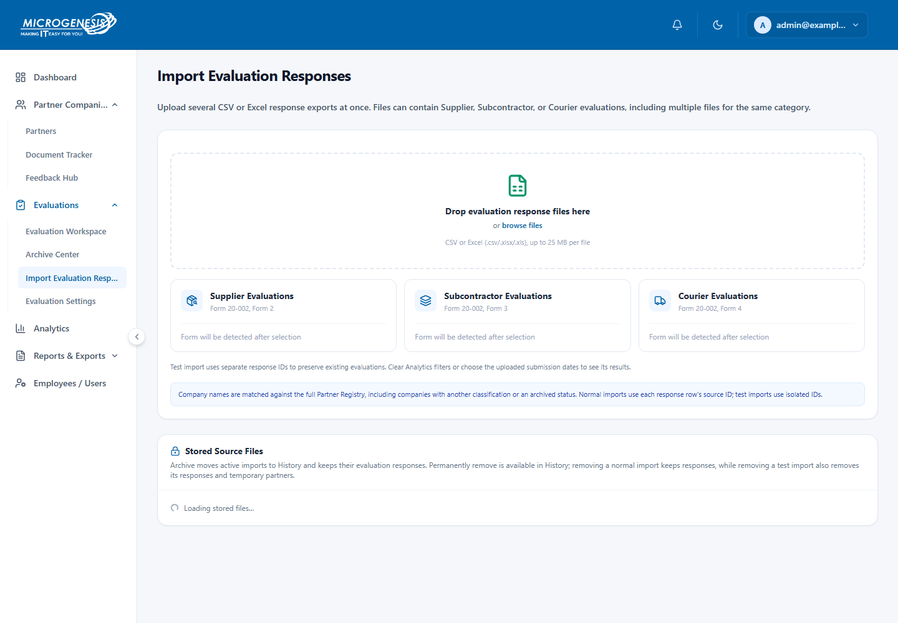

## Evaluation Category Labels

Use **Evaluations** → **Evaluation Workspace** → **Category Labels** to change the displayed names of the scoring categories for each survey type.

1. Select Courier, Supplier, or Subcontractor.
2. Edit the category names.
3. Save your changes. Use the restore-default option if you need the original names back.

Changing a label changes its name on screen; it does not change the scoring weights.

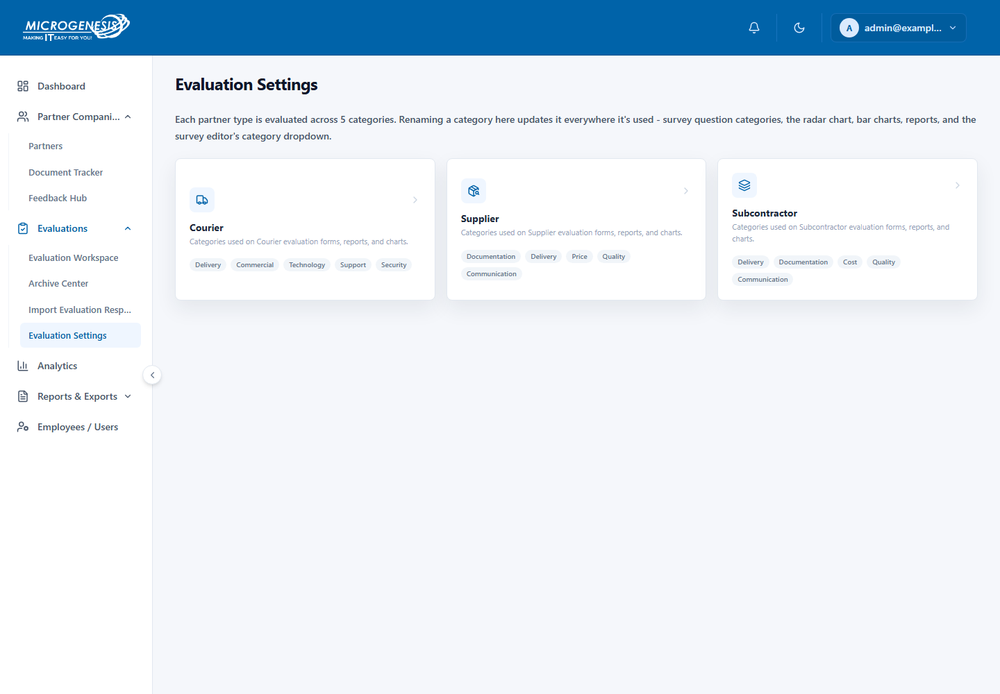

## Analytics

Analytics turns survey answers into charts, trends, and company rankings. Use **Current**, **All time**, or **Custom** to choose which period to review. Use the page filters to narrow the view by survey type or company. The company-ranking area also has an archives view for older periods.

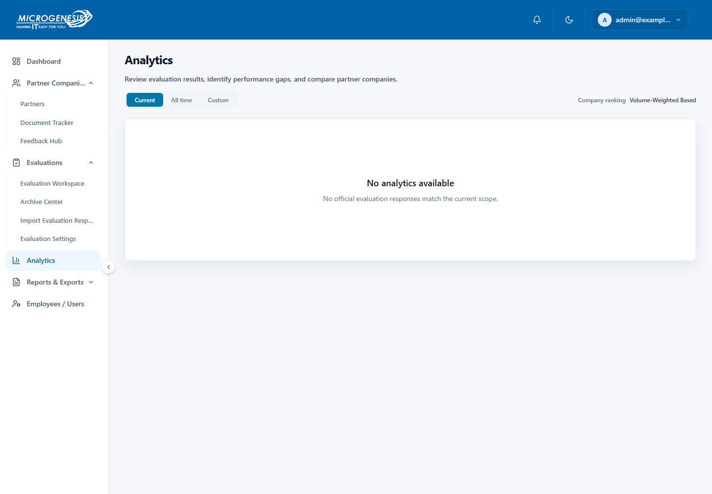

## Generate Report

Open **Reports & Exports** → **Generate Report** to prepare a summary, company, question, or executive report.

1. Choose the report card that matches the question you are trying to answer.
2. Select the survey type, date range, or company filters shown in that report.
3. Review the report on screen.
4. Choose **Export** and select PDF, Excel, or CSV when available.

If an export option is disabled, your account may not have export permission.

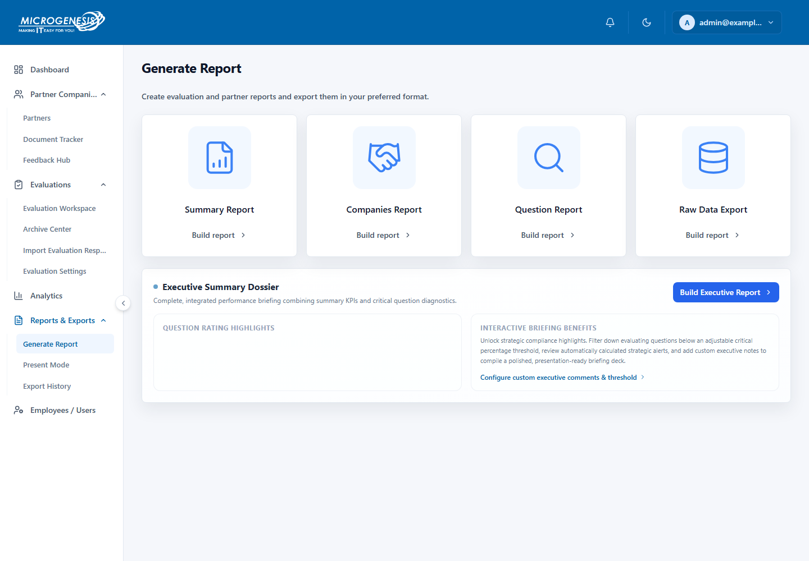

## Present Mode

Present Mode turns the selected evaluation results into a slide-style presentation.

1. Open **Reports & Exports** → **Present Mode**.
2. Choose the survey categories and date range you want to show.
3. Select **Generate Presentation**.
4. Review the slides, then export the presentation in the format offered on the page.

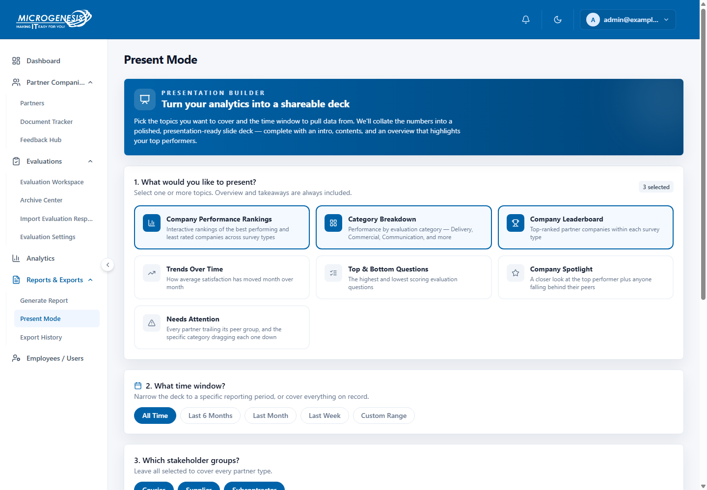

## Export History

Export History lists reports exported from this browser. Search by report name or file name to find a recent export. Clearing the history removes the list from this device; it does not delete files already downloaded to your computer.

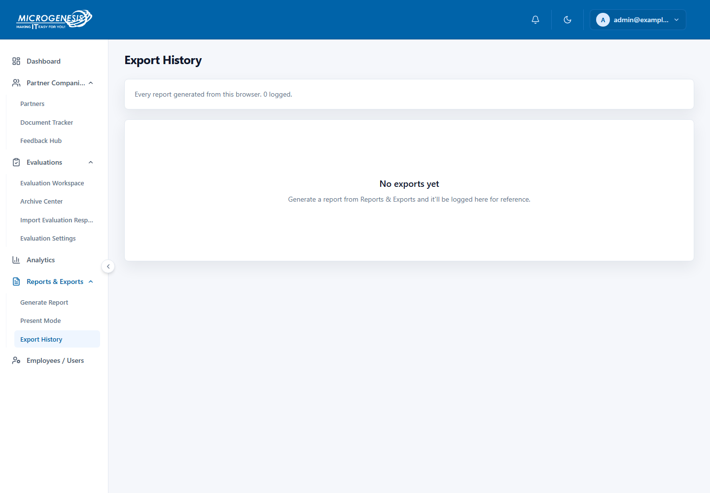

## Employees / Users

Use **Employees / Users** to add accounts and control what employees can open.

1. Choose **Add Account** and enter the employee's company email.
2. Set their role, designation, and department.
3. Review the pages and survey types they can use, then save the account.
4. Share any initial password privately. Do not send it in a group chat.

The system sets starting access from the employee's role, designation, and department. You can adjust one person's access or set a department-wide access limit. Give employees only the access they need.

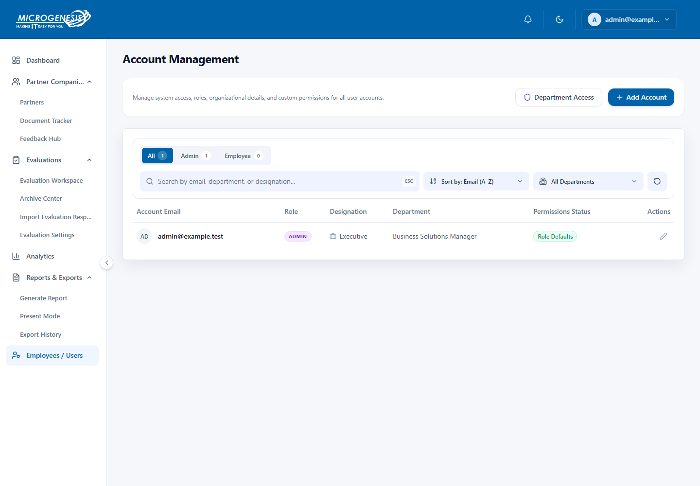

## Notifications

Select the bell in the top-right corner, then open **All Notifications**. The list can include new survey submissions and partner-document expiry alerts.

Use the search and filters to find an item. Open an alert to check its details, including the affected company or branch and due date. You can mark items as read or unread.

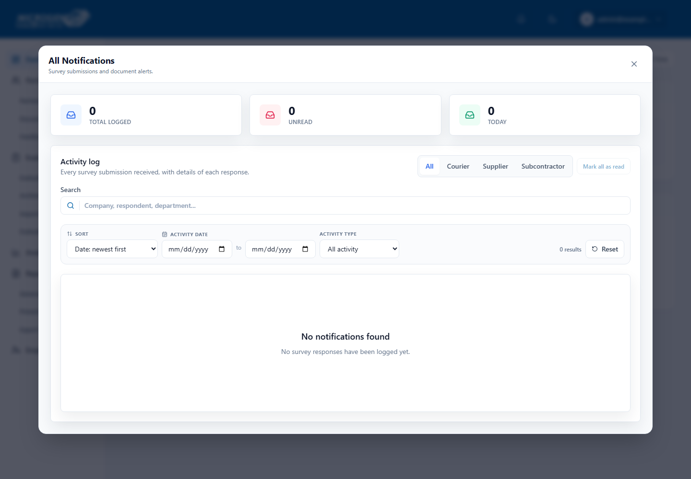

## Settings

Open the account menu in the top-right corner, then choose **Settings**. From here you can review your account, change the display theme, review recent activity, and sign out. The system tools are for administrators; use them only when you understand the effect of the action.

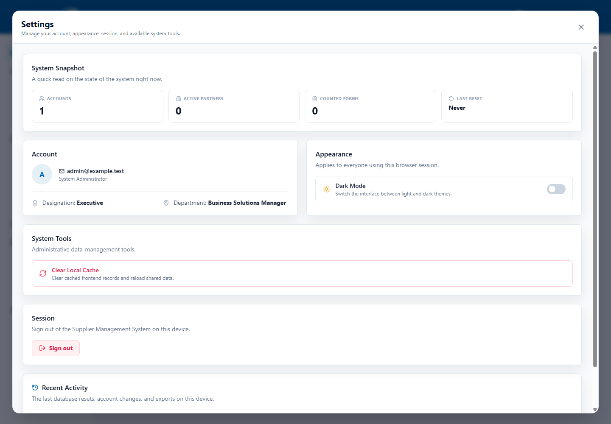

## Quick help

- **A page is missing:** access may depend on the employee's role, department, or a custom permission. Review the account in Employees / Users.
- **No forms or companies appear:** check the filters and date range, then check whether the partner or survey has been added and published.
- **A report cannot be sent by email:** ask IT whether Microsoft email is configured.
- **An import asks to replace a file:** stop and check the duplicate and the file contents before confirming.
