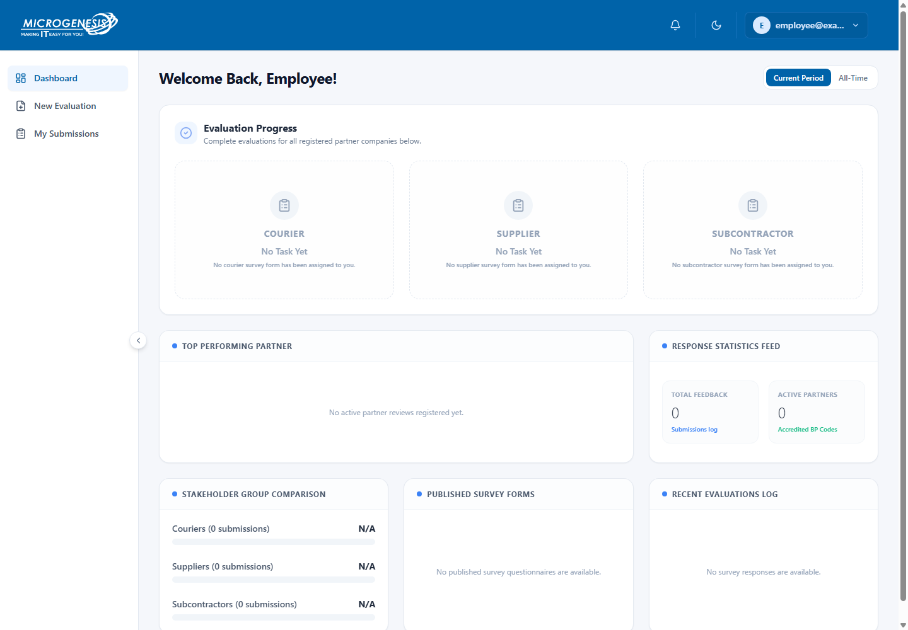
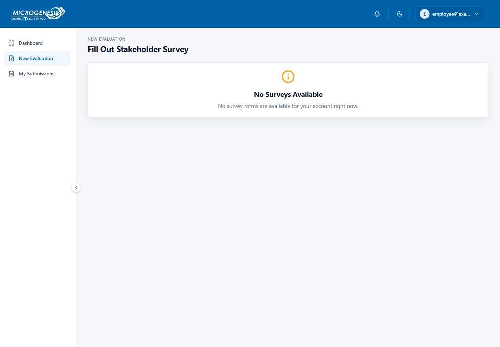
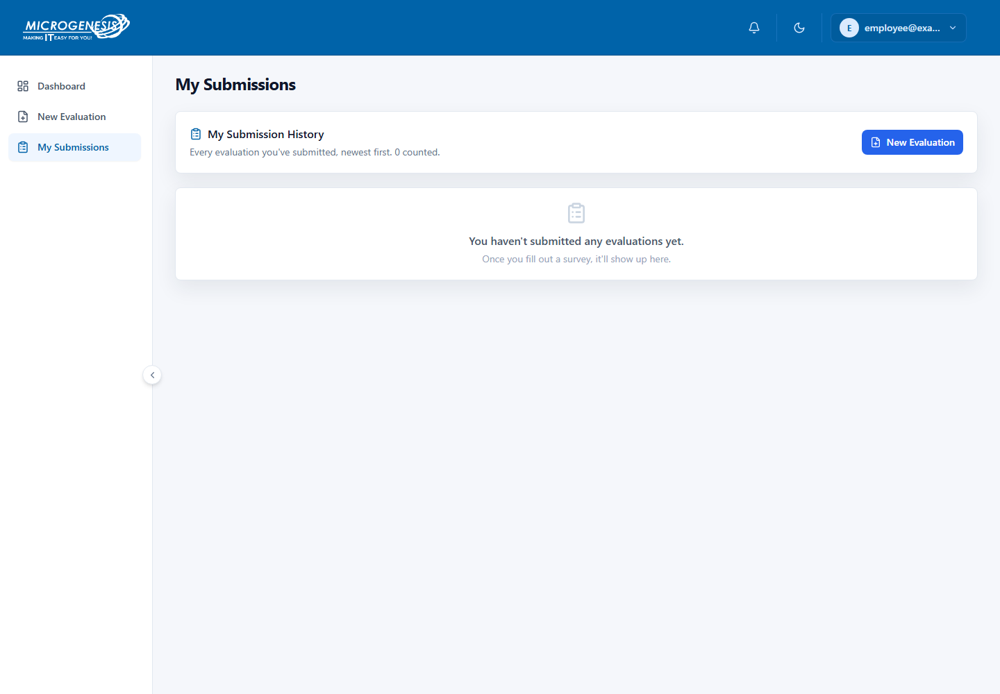
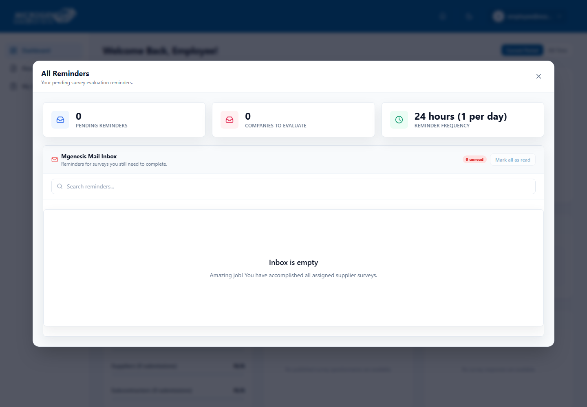
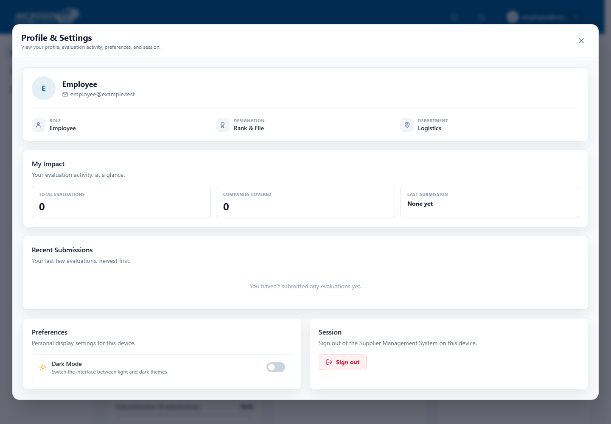

# Employee User Guide

This guide shows the everyday employee screens and explains how to complete and review a partner evaluation.

## Sign in and find your way around

Use your company email and the password provided by your administrator. Some deployments may offer Microsoft sign-in. If you do not have an account or cannot sign in, contact your administrator. Keep your password private.

The employee menu has **Home**, **Evaluations**, and **My submissions**. Your top-right bell shows reminders. Select the question mark beside the bell to open the quick guide. The account menu opens your profile and settings. Your available forms depend on your assignments and access.

The pictures in this guide show a clean preview account with no assigned forms or submissions. The example email address and empty counts are not real company data. Your screen will show the information available to your account.

## Dashboard

The Dashboard is your home page. The **Evaluation Progress** area shows which Courier, Supplier, or Subcontractor surveys are waiting for you. Other panels show the latest activity available to your account.

If a survey says **No Task Yet**, no form of that type is currently assigned to you. Ask your manager or administrator if you think something is missing.

## New Evaluation

Use **New Evaluation** to send feedback about an assigned partner company.

1. Open **New Evaluation**. If the page says **No Surveys Available**, ask your administrator whether a form has been published and assigned to you.
2. Choose the survey and company shown for your assignment.
3. Complete the respondent information. Your department and designation may already be filled in from your account.
4. Choose **Proceed to Form Questions**.
5. Answer each question using the choices or number range shown. Choose **N/A** only when the form allows it. Add a comment when it helps explain your answer.
6. Check your answers and choose **Submit Evaluation**.

If you leave after starting the questions, the system may ask whether you want to save a draft. A saved draft stays on the device and browser where you started it. Return to the form on that device to continue.

## My Submissions

Open **My Submissions** to review evaluations you have sent. Use the search box to find a company or survey type. Select a submission row to expand it and see your answers.

If the page says you have not submitted any evaluations yet, check that the form was submitted successfully. Drafts do not appear as submitted evaluations.

## Reminders

Select the bell at the top of the screen and choose **All Reminders** to open your reminder inbox.

- Review which assigned companies still need an evaluation.
- Select **Start Evaluation Now** when you are ready to complete a reminder.
- Use search to find a reminder and the read controls to keep track of it.

## Profile & Settings

Open the account menu at the top-right and choose **Profile & Settings**. This page shows your account role, designation, department, and your recent evaluation activity. You can change the display theme or sign out here.

## Quick help

- **No survey is available:** ask your manager or administrator to check the survey assignment and your account access.
- **Your department or designation is missing or wrong:** contact an administrator before submitting an evaluation.
- **A reminder seems incorrect:** open it and check the survey and company. If it still looks wrong, tell your administrator.
- **You cannot find an old evaluation:** check My Submissions and clear the search text. Only submitted evaluations appear there.
