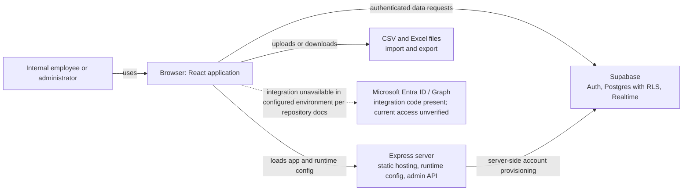
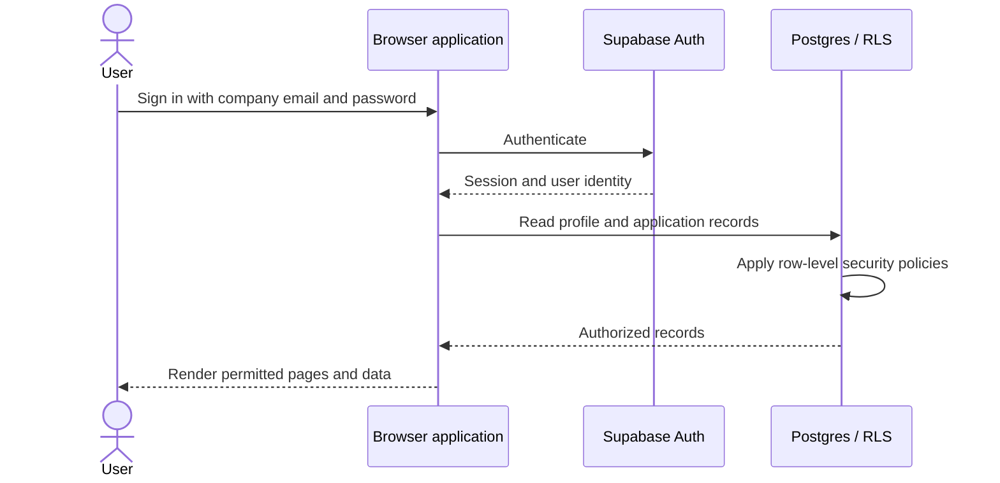
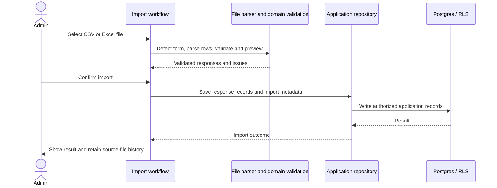

# Supplier Management System — Current-State System Design

| Document field | Value |
|---|---|
| Version | 0.1 (draft) |
| Baseline date | 12 October 2026 |
| Document status | Repository-derived; pending technical-owner validation |
| System status | Pre-production; deployment readiness is not established |
| Related document | [Current-State Business Requirements](./BRD_CURRENT_STATE.md) |

## 1. Purpose and evidence

This document describes the software structure and runtime design represented by the current repository. It is an as-is design description, not a target architecture or proof that a hosted environment is configured correctly. Application source, package scripts, configuration contracts, and versioned database migrations are the primary evidence. Environment-specific statements require a separate authorized check.

## 2. System context

The Supplier Management System is an internal web application for employee evaluation workflows, partner records, compliance documents, imports, analytics, and reporting. The repository does not implement a partner self-service portal.

## 3. Runtime and deployment structure

### 3.1 Browser application

`src/main.tsx` obtains runtime configuration from `/api/config`, configures authentication support, then loads the React application. If that endpoint is unavailable, the client can use the Vite public environment configuration. `src/App.tsx` composes page routing, authenticated profile and permissions, shared survey data, and feature pages.

The UI uses React and TypeScript. Vite provides development and production build tooling; Tailwind CSS is used for styling. Route state is composed in the client using the page key and routing helpers rather than a server-rendered route tree.

### 3.2 Express server

`server.ts` serves the built frontend in production and the Vite middleware during development. It exposes:

| Endpoint | Purpose |
|---|---|
| `GET /api/config` | Returns browser-safe runtime configuration. |
| `GET /api/health` | Basic server health response. |
| `POST /api/admin/accounts` | Server-side account provisioning; requires a private server credential. |

The public browser configuration is intended for the Supabase URL and publishable key. Private service credentials must remain server-side. Static hosting without the Express configuration endpoint depends on Vite-provided public configuration.

### 3.3 External services

Supabase provides user authentication and Postgres persistence with row-level security. Realtime is used to signal changes. The repository includes Microsoft Entra and Graph integration code, but current repository documentation says Azure access/configuration is unavailable; successful sign-in exchange or email delivery is therefore not asserted here.

## 4. Application structure

The frontend is organized around route-level pages and feature-oriented modules:

| Layer | Current responsibility |
|---|---|
| `src/main.tsx` | Bootstrap, runtime config, authentication client setup. |
| `src/App.tsx` | Authenticated application composition, page selection, shared state and handlers. |
| `src/pages/` | Route-level screen composition and workflow orchestration. |
| `src/features/` | Focused feature components, domain rules, services, and types for areas such as analytics, evaluations, imports, and active companies. |
| `src/hooks/` | React state and lifecycle orchestration, including shared modal and session behavior. |
| `src/services/` | Persistence, authentication, and external I/O boundaries. `applicationRepository.ts` is the shared application-record persistence boundary. |
| `src/utils/` | Shared domain-neutral and application-level helpers, including page routing and permission calculations. |
| `src/types/` | Shared business and UI contracts, including survey and partner models. |

The current top-level page composition includes dashboard, partner registry, document register, surveys and submissions, analytics, reporting, imports, archive, account management, feedback, settings, and presentation views. Page-level permission checks govern navigation and visibility; database policies govern protected data access.

## 5. Data and persistence design

### 5.1 Persistence model

The current design has two principal database layers:

1. `app_profiles` stores authenticated user profile and access attributes.
2. `application_records` stores editable application entities as JSON payloads, keyed by record type and record ID.

The database constrains supported record types. The current frontend repository declares 19 application-record types. Examples include partner companies, surveys and responses, archive series, department permissions, category labels, feedback, document notification rules, activity history, export history, compliance snapshots, and evaluation import archives. Individual payload schemas are parsed at the application boundary.

Normalized company and form tables also exist as a reference/import and audit layer; frontend writes to shared editable state pass through the application repository or a focused service built on it. Document renewal uses the `renew_partner_document` RPC where available in the tracked database design. A tracked migration is not evidence that it has been applied to a hosted environment.

### 5.2 Browser-local state

Browser storage is used for local cache and device-specific state. It is not the canonical shared source of truth. Shared records are loaded through the repository and database authorization boundary. The precise keys and lifecycle vary by feature and are defined in source.

### 5.3 Realtime

Realtime events are treated as invalidation signals. On a relevant event, the client reloads records through the repository so current RLS policies are applied; event payloads are not treated as an alternate unrestricted data feed.

### 5.4 Evaluation and import records

Evaluation responses retain survey, company, respondent, answer, timestamp, batch, and provenance information. The provenance rules distinguish official submissions and ordinary CSV imports from isolated test submissions. Test submissions are excluded from official analytics by the shared provenance domain logic. Stored import source files can be reviewed and moved into import history; destructive cleanup has separate behavior for test and ordinary imports.

## 6. Authentication and authorization

### 6.1 Authentication

The current implemented sign-in path uses Supabase email/password and restricts accepted company addresses to `@mgenesis.com`. Password recovery is present. Microsoft authentication is not described as active because the repository does not establish current Azure configuration.

The browser receives only public configuration. Account creation requiring elevated Supabase access is routed through the Express server and its private credential boundary.

### 6.2 Authorization

Authorization uses user profile attributes, including role, designation, department, survey-type access, page permissions, department ceilings, and account-specific overrides. The UI uses these values to control page access and actions. These checks improve the user experience but do not replace database authorization.

Postgres RLS is the data boundary for authenticated access. Policies scope profile, application-record, and normalized-table operations. Survey response reads are restricted according to the current policy model (including administrative, seniority, department, and own-response scopes). The Archive Center is restricted to administrators in the page access logic.

Repository review identifies a remaining Analytics gap: a protected aggregate endpoint for company-wide lower-rank analytics was not found in current source/migrations. Raw response access must not be widened to solve this; the current frontend-to-database alignment note calls for a protected aggregate design.

### 6.3 Session lifecycle

The frontend includes an inactivity warning and automatic logout lifecycle. The configured behavior is a warning after 25 minutes and logout at 30 minutes of inactivity. Hosted identity-provider session behavior should be verified separately.

## 7. Core runtime flows

### 7.1 Sign-in and shared-data load

### 7.2 Evaluation import

Import parsing and data mapping are client-side in the current implementation. Database authorization still applies to shared record writes. Operational limits for file size, throughput, and retention are not defined by this design document.

### 7.3 Document renewal

Document and partner data are edited through the partner/document workflows. The renewal path delegates the renewal operation to a database RPC so the related change is handled at the persistence boundary. The current migration state and policies must be confirmed in the target environment before relying on this flow there.

## 8. Main domain areas

| Domain | Current design responsibility |
|---|---|
| Partner registry | Supplier, Courier, and Subcontractor companies, branches, and associated accreditation details. |
| Surveys and responses | Form configuration, evaluation completion, response review, score calculation, and archival. |
| Analytics and reports | Filter and present authorized evaluation information; prepare tabular and presentation exports. |
| Evaluation imports | Parse evaluation exports, validate and match company names, import responses, isolate test data, and manage source-file history. |
| Compliance documents | Track partner document details, expiry, status, notifications, and modifications. |
| Administration | Manage employee profiles, module and survey access, categories, and selected system settings. |
| Feedback | Capture and manage internal feedback reports and related contact/settings data. |

## 9. Security and operational boundaries

- Supabase RLS is the authorization boundary for database rows; hidden UI controls alone are not sufficient protection.
- Public Vite configuration must not contain service-role keys, OAuth secrets, database passwords, or other private credentials.
- Server-side account provisioning is the elevated operation exposed by Express and must remain protected by server credentials and authorization checks.
- Imported files and business records may contain confidential partner, employee, or survey data. They should not be copied into logs or committed as fixtures without explicit approval.
- Repository code and migrations do not prove production deployment, remote migration status, backup configuration, service levels, or recovery readiness.
- The repository does not establish formal data-retention periods, recovery objectives, availability targets, or production support ownership.

## 10. Current design gaps and verification items

1. **Production environment:** Verify runtime configuration, deployed build, identity provider, migration state, RLS policies, Realtime configuration, and recovery behavior in the intended environment.
2. **Lower-rank Analytics:** Define a protected aggregate query/service if company-wide rollups are required without granting access to raw responses.
3. **Microsoft integration:** Confirm whether Entra sign-in exchange and Graph email delivery are intended to be enabled, then verify configuration and least-privilege scopes.
4. **Delegated document renewal:** Confirm the tracked RPC migration is reviewed and applied before relying on renewal in a hosted environment.
5. **Operations:** Assign service/data owners and define monitoring, retention, backup, recovery, and availability expectations before production use.

These items describe unresolved verification or design work; they are not asserted as approved product decisions.

## 11. Source map

- Bootstrap and runtime configuration: `src/main.tsx`
- Application composition and page state: `src/App.tsx`
- Express routes and hosting: `server.ts`
- Shared application persistence: `src/services/applicationRepository.ts`
- Supabase client configuration: `src/services/supabaseClient.ts`
- Page and profile permission rules: `src/utils/rbac.ts`
- Survey and response contracts: `src/types/survey.ts`
- Evaluation provenance: `src/features/analytics/domain/responseProvenance.ts`
- Frontend/database alignment and known gaps: `docs/engineering/SUPABASE_FRONTEND_ALIGNMENT.md`
- Durable project context: `docs/engineering/SECOND_BRAIN.md`
- Related business requirements: [BRD_CURRENT_STATE.md](./BRD_CURRENT_STATE.md)
